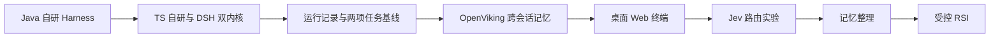

# CN Code 演化路线

## 起点：研究 Harness，用 DeepSeek 写代码

用户确认最初使用 ChatGPT Codex 辅助开发，目的是理解 Harness 底层逻辑；CN Code 运行时接入 DeepSeek，主要用于写代码。开发助手与运行模型是两个概念。最早使用的具体模型版本尚未确认。

公开仓库两次提交都在 2026-06-13，只能证明上传时间，不能据此推断实际开发起点或使用了哪个 GPT 版本。起始基线为 `03ffabf7ca1edceea85301d2df0815f76baa3c2d`。

Java 已有：AgentLoop、文件与 shell 工具、权限、Web/TUI/REPL、JSONL 会话、指令 include、压缩、文件记忆、Skill 和 MCP。原规格已归档到 `docs/specs/legacy-session-memory/`。

## 本轮路线

| 阶段 | 动机 | 借鉴或复用 | 验证证据 | 当前状态 |
|---|---|---|---|---|
| Java 起点 | 理解 Agent 如何持续执行编码任务 | 自研循环、工具、会话 | 历史 Java 源码及 smokeTest | 源码已有；本轮重新验证另记 |
| TS 主线 | 接入 DSH，保持自己的内核可演进 | 原 Java 边界、DSH SDK | 类型检查、内核行为测试、真实运行记录 | 实施中 |
| 运行与评测 | 从手动看效果转为可复现比较 | DSH 稳定工具 ID、usage；公开编码任务 | 每次运行的报告和受保护验收 | 待验证 |
| 跨会话记忆 | 减少重复解释和重复探索 | OpenViking 插件与 SDK；Claude Code 按需记忆思路 | 新会话召回、项目隔离、更新纠正 | 待验证 |
| 多客户端 | 日常自用，完整处理审批和追问 | 共用服务协议与 UI | 实际桌面、Web、终端验收及截图 | 待验证 |
| Jev | 判断轻量路由是否值得 | TypeSafe Jev | 带回退的路由对照实验 | 后续计划 |
| 记忆整理 | 合并重复、更新旧结论 | Dreams 的独立输出与审核思路 | 差异、版本、回滚与独立成本 | 后续计划 |
| RSI | 在证据支持下优化单个 Skill | 版本快照、固定基线与保留集 | 候选与基线对比，失败回滚 | 后续计划 |

## 参考边界

- [DeepSeek Harness](https://github.com/deepseek-ai/deepseek-harness)：SDK、会话事件、插件扩展。Super-agent prototype 的配置快照可借鉴；不把任务准入 Eval 当编码质量评测。
- [OpenViking DSH 集成](https://github.com/volcengine/OpenViking/blob/main/docs/en/agent-integrations/17-dsh.md)：现成召回与捕获插件。DSH alpha.2 需本项目验证，不能因 peer 范围允许就说兼容已验证。
- [Claude Code Memory](https://code.claude.com/docs/en/memory)：短索引和按需读取；不把全部对话都当长期记忆。
- [Dreams](https://platform.claude.com/docs/en/managed-agents/dreams)：Managed Agents 研究预览，输入不改、整理结果另存；本项目尚未接入这一托管 API。

## 面试口述：按证据更新

已经可以说：“一开始我就是为了研究 Harness 底层逻辑，自己搭了 CN Code，接 DeepSeek 写代码。当时更多是给几个具体任务让它跑，看交付效果，也会留意耗时和工具执行。”

后续完成相应验收后再说：“后来发现凭印象比较不太可靠，就把耗时、token、工具调用和交付结果统一记录下来，固定几个任务做回归。再往后加跨会话记忆，也用相同任务验证有没有减少重复探索，同时记录它额外的开销。”

没有运行结果时只能介绍设计与实现，不编造成功率、性能提升或公司项目经历。验收清单与 `docs/validation.md` 是本轮状态依据。

## 2026-11-02 接续增量

已实现并用自动检查验证：运行生命周期与清理顺序、请求去重和 purpose 分账、未知 token、并发人工等待区间、工具取消与历史配对、记录恢复、旧 MCP 配置迁移。DSH 通过实际子进程和本地模型协议夹具验证执行层观测与恢复；不等于真实模型能力验证。

已实际尝试：两任务×两内核的 Linux 无记忆调用。四次均遇到提供方 401，归入环境错误；不能据此推导编码成功率或性能。下一个真实实验门槛仍是有效凭据与可信验收器正反例，然后才比较记忆收益和开销。

用户新增界面要求：UI 先通过 Figma MCP 设计，参考 Codex 黑白风格，深色和浅色作为独立主题。该要求属于本轮客户端阶段，不引入 Jev、Dreaming 或 RSI 实现。

## 当前可复述的增量

已实现并实际运行黑白主题的 Web 与 Electron，以及可在运行中停止的交互终端。界面先经 Figma MCP 创建可编辑设计，再接现有服务。客户端交互与 DSH 原生回调用本地模型/内核协议夹具验证；Electron 还能恢复并展示真实提供方失败记录。这里可以讲协议设计与验证方法，不能讲真实模型已经完成任务。

可信验收器通过参考解/错误解正反例，修正了测试启动配置错误。下一步仍是更新本地凭据取得有效无记忆编码基线；然后对接 OpenViking 严格项目范围，验证纠正与隔离，再进行收益/开销对照。Jev、记忆整理、RSI 没有进入本轮实现。

## 新凭据后的事实增量

已有首组真实无记忆基线：phone-number和kv-store-grpc分别在CN Code与DSH内核通过外部可信验收，提供方实际usage与工具轨迹已保存。曾发生额外smoke与部分运行重叠，明确记录并无并发重跑受影响项。发现并修正无人值守审批等待的actor分类，保留原始数据与归一化解释。

现在可以介绍“固定两类任务，用两种内核实际运行并由独立验收器检查交付”，但每组合一个样本不足以声称稳定成功率、内核速度优势或记忆收益。下一步是OpenViking真实服务、embedding与隔离，再进行记忆对照。

## 本地记忆的事实增量

OpenViking 本地存储、现有 DeepSeek 提取、本地 BGE 检索已经实际运行。为了避免用户级记忆跨项目混用，采用项目专属本地账户；同时兼容用户级和peer级记忆，实测搜索、读取、任务与伪造账户头不能取得另一项目的约定。自研和DSH新会话能复用随机配置约定，纠正后能采用新端口。

实验曾暴露污染：DSH 在关闭记忆时通过文件工具读到了评测报告。该样本保留但不作为收益证据；随后限制实验工具与可读文件，以新随机约定重跑。最终记录的收益是“跨会话不必重复提供约定仍能交付正确配置”；显式给定值的控制中，两内核的记忆版本都增加了本次开销，未声称记忆普遍提速。

现在可以讲本地部署、项目命名空间、异步提交/完成边界、提供方usage与本地估计的区别，以及如何发现并修正评测污染。还不能讲同一编码基准的稳定提升、长期生产收益、自动整理或RSI。后续用重复样本与更长真实任务验证，保留失败和新增开销。
